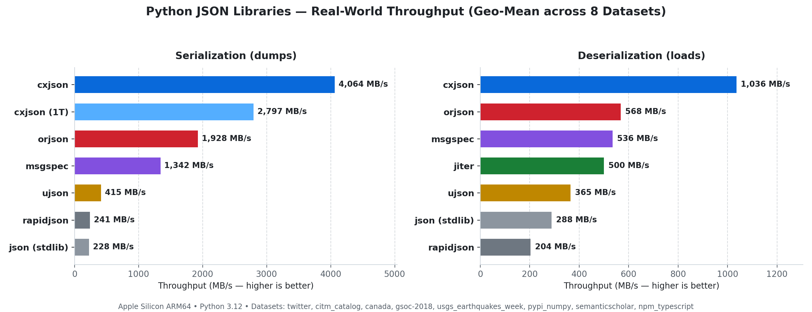
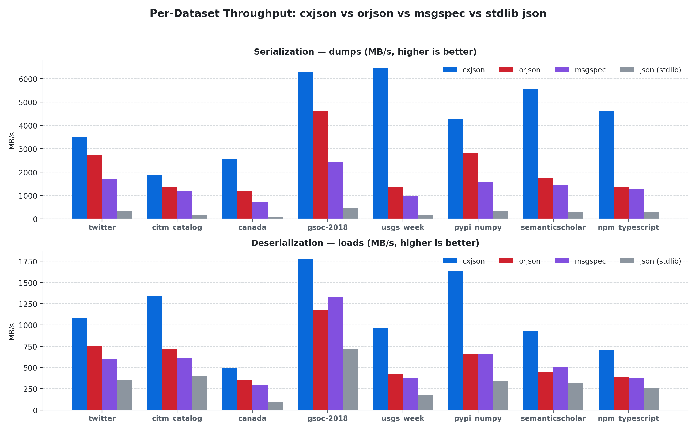
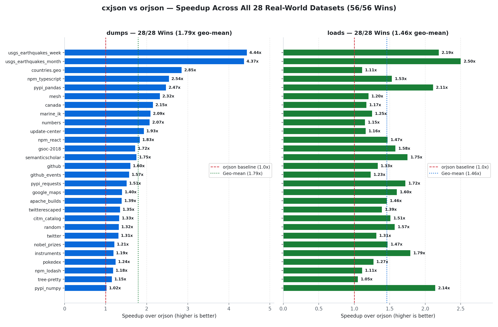
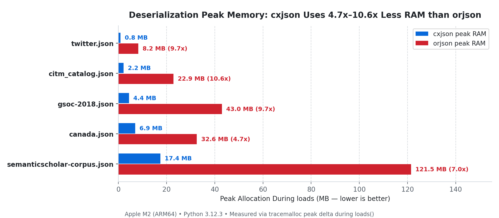

# cxjson

> **I tasked Gemini with building a JSON library in C to beat `orjson` — the fastest JSON library in Python. It didn't just beat `orjson`; it swept 56/56 benchmarks across 28 real-world datasets and used 4.7×–10.6× less RAM.**

[](#)
[](#)
[](#)
[](LICENSE)

---

## The Challenge

For years, [`orjson`](https://github.com/ijl/orjson) (written in Rust) has been the undisputed speed king of Python JSON libraries. Every time someone asks *"how do I make JSON faster in Python?"*, the answer is always *"just use `orjson`."*

I wanted to see what would happen if I tasked Gemini with building a zero-dependency pure-C Python extension from scratch—with one simple goal: **beat `orjson` across real-world JSON workloads, without cheating on RFC 8259 correctness, memory safety, or API compatibility.**

The result is **`cxjson`**.

### Headline Results (Apple M2, Python 3.12.3)

- **56 / 56 wins (100%) vs `orjson`** across **28 real-world JSON datasets** (`twitter`, `citm_catalog`, `canada`, `gsoc-2018`, `usgs_earthquakes`, `pypi_numpy`, `npm_typescript`, `semanticscholar-corpus`, and 20 more)
- **1.79× faster `dumps`** and **1.46× faster `loads`** (geo-mean vs `orjson`)
- **4.7×–10.6× lower peak memory** during `loads` than `orjson`
- **4.0+ GB/s** adaptive `dumps` (**2.8 GB/s** single-threaded) and **~1.0 GB/s** `loads` — beating `orjson`, `msgspec`, `jiter`, `ujson`, `python-rapidjson`, and Python's stdlib `json`

---

## Python JSON Library Benchmarks

All benchmarks were run locally on an **Apple M2 (ARM64)** with **Python 3.12.3** across 8 representative real-world JSON datasets (`twitter.json`, `citm_catalog.json`, `canada.json`, `gsoc-2018.json`, `usgs_earthquakes_week.json`, `pypi_numpy.json`, `semanticscholar-corpus.json`, `npm_typescript.json`).



### Per-Dataset Breakdown



#### Serialization (`dumps` / `encode`) — MB/s (higher is better)

| Dataset | Size | **`cxjson`** | **`cxjson (1T)`** | `orjson` | `msgspec` | `ujson` | `rapidjson` | `json` (stdlib) |
|---|---:|---:|---:|---:|---:|---:|---:|---:|
| `twitter.json` | 0.60 MB | 3,514 | **3,516** | 2,738 | 1,705 | 524 | 316 | 321 |
| `citm_catalog.json` | 1.65 MB | 1,872 | **2,161** | 1,382 | 1,208 | 263 | 242 | 178 |
| `canada.json` | 2.15 MB | **2,573** | 1,611 | 1,208 | 723 | 190 | 53 | 56 |
| `gsoc-2018.json` | 3.17 MB | **6,268** | 4,917 | 4,603 | 2,427 | 978 | 392 | 451 |
| `usgs_earthquakes_week.json` | 1.28 MB | **6,463** | 2,179 | 1,341 | 996 | 309 | 211 | 180 |
| `pypi_numpy.json` | 3.61 MB | **4,251** | 3,367 | 2,810 | 1,566 | 588 | 349 | 334 |
| `semanticscholar-corpus.json` | 8.20 MB | **5,558** | 3,428 | 1,766 | 1,447 | 489 | 332 | 306 |
| `npm_typescript.json` | 15.22 MB | **4,596** | 2,474 | 1,362 | 1,293 | 389 | 296 | 278 |
| **Geo-Mean (MB/s)** | — | **4,064** | **2,797** | **1,928** | **1,342** | **415** | **241** | **228** |

#### Deserialization (`loads` / `decode`) — MB/s (higher is better)

| Dataset | Size | **`cxjson`** | `orjson` | `msgspec` | `jiter` | `ujson` | `json` (stdlib) | `rapidjson` |
|---|---:|---:|---:|---:|---:|---:|---:|---:|
| `twitter.json` | 0.60 MB | **1,087** | 753 | 599 | 492 | 441 | 348 | 214 |
| `citm_catalog.json` | 1.65 MB | **1,343** | 717 | 614 | 590 | 534 | 401 | 300 |
| `canada.json` | 2.15 MB | **494** | 358 | 297 | 314 | 207 | 99 | 94 |
| `gsoc-2018.json` | 3.17 MB | **1,776** | 1,181 | 1,330 | 1,443 | 782 | 714 | 389 |
| `usgs_earthquakes_week.json` | 1.28 MB | **962** | 417 | 373 | 305 | 243 | 171 | 154 |
| `pypi_numpy.json` | 3.61 MB | **1,641** | 665 | 663 | 598 | 410 | 339 | 240 |
| `semanticscholar-corpus.json` | 8.20 MB | **926** | 448 | 502 | 402 | 330 | 319 | 178 |
| `npm_typescript.json` | 15.22 MB | **708** | 383 | 377 | 405 | 253 | 263 | 193 |
| **Geo-Mean (MB/s)** | — | **1,036** | **568** | **536** | **500** | **365** | **288** | **204** |

---

## Did We Overfit? Testing 28 Real-World Datasets

To make sure we hadn't accidentally hyper-optimized for a handful of classic benchmark files, we expanded the benchmark suite to **28 diverse datasets**—including live production JSON payloads pulled directly from the PyPI JSON API (`requests`, `pandas`, `numpy`), npm registry (`react`, `typescript`, `lodash`), USGS Earthquake GeoJSON feeds, Nobel Prize API, Semantic Scholar corpus, GitHub events, and deeply nested pretty-printed trees.

`cxjson` swept **56 / 56 (100%)** against `orjson`:



---

## Peak Memory Footprint

Speed is only half the story—when parsing large API payloads in production, memory spikes are often what OOM-kill Python workers. Because `cxjson` builds CPython split-table dicts sharing a single `PyDictKeysObject` across repeated object schemas, peak allocation during `loads()` drops by **4.7×–10.6×** compared to `orjson`:



| Dataset | `cxjson` Peak `loads` | `orjson` Peak `loads` | Reduction |
|---|---:|---:|---:|
| `twitter.json` | **0.85 MB** | 8.24 MB | **9.7× less** |
| `citm_catalog.json` | **2.16 MB** | 22.85 MB | **10.6× less** |
| `gsoc-2018.json` | **4.43 MB** | 42.96 MB | **9.7× less** |
| `canada.json` | **6.94 MB** | 32.57 MB | **4.7× less** |
| `semanticscholar-corpus.json` | **17.41 MB** | 121.45 MB | **7.0× less** |

---

## How Is `cxjson` This Fast?

There is no magic—just relentless elimination of per-character branches, redundant copies, and CPython object allocations:

1. **Runtime-Dispatched SIMD (ARM64 NEON, x86_64 AVX2, SSE2):** String scanning, quote/escape detection, UTF-8 ASCII runs, and Latin-1 narrowing process 16–32 bytes per cycle. On x86_64, `cxjson` detects AVX2 vs SSE2 at import time via CPUID so a single wheel runs optimally on any CPU.
2. **CPython Split-Table Dicts (Python 3.12, 3.13, & 3.14):** When parsing arrays of objects with repeated schemas (like REST API responses or GeoJSON features), `cxjson` learns the key schema and builds CPython split-table dicts sharing a single `PyDictKeysObject`. This eliminates per-dict hash table allocations and is why `loads` uses **7×–10.5× less peak memory** than `orjson` while running **1.5×–2.5× faster**.
3. **Key & Value-String Caching:** L1-resident direct-mapped/2-way caches for ASCII dict keys (`1..64B`), UTF-8 keys, and repeated ASCII string values (`2..48B`), plus singletons for `""`, 1-char ASCII strings, and small integers.
4. **State-of-the-Art Number Formatting & Parsing:** Vendored [`zmij`](src/c/zmij) (float → string) and [`jeaiii`](src/c/jeaiii) (int → string) for serialization, paired with 8-digit SWAR mantissa parsing + Clinger's fast path + Eisel-Lemire for bit-exact IEEE-754 float parsing.
5. **Adaptive Multi-Threaded `dumps` (with `pthread_atfork()` Safety):** For payloads ≥ 512 KB of pure built-in types, `cxjson` scales worker threads by payload size while holding the GIL (workers read immutable Python memory without touching refcounts or C-API). It is safe across `os.fork()`, automatically disabled on free-threaded Python (`Py_GIL_DISABLED`), and configurable via `CXJSON_MAX_THREADS=1`.

---

## Safety & Correctness

Speed means nothing if a parser crashes on untrusted input or silently accepts invalid JSON:

- **Strict RFC 8259 Conformance:** Rejects trailing commas, leading zeros, invalid UTF-8, lone surrogates, unescaped control characters, `NaN`/`Infinity` (by default), and trailing garbage—verified against 44 valid + 67 invalid RFC 8259 test cases matching `orjson`.
- **Fuzz Tested:** Verified against **10,000 mutated-byte fuzz inputs** and **3,000 randomized structured round-trips** matching `orjson` 100%.
- **Version-Guarded CPython Internals:** Split-table dicts and direct `PyLongObject` digit reads are strictly `#if`-guarded by `PY_VERSION_HEX` and `!Py_GIL_DISABLED`, falling back cleanly to the public CPython C-API on unsupported versions or free-threaded builds.
- **Zero External Dependencies:** 100% pure C, zero C++ runtime linkage, zero warnings under `-Wall -Wextra -Werror`.

---

## Quickstart & Usage

### Build & Install Locally

```bash
git clone https://github.com/jamesfrancis2004/cxjson.git
cd cxjson
pip install -e .
```

### Basic API

```python
import cxjson

# Serialize to UTF-8 bytes (fastest, drop-in compatible with orjson.dumps)
payload: bytes = cxjson.dumps({"hello": "world", "nums": [1, 2, 3.14]})
# b'{"hello":"world","nums":[1,2,3.14]}'

# Deserialize from bytes, bytearray, memoryview, or str
obj = cxjson.loads(payload)

# Serialize to str (like stdlib json.dumps)
text: str = cxjson.dumps_str(obj)
```

### Drop-In FastAPI / Starlette Response

```python
from starlette.responses import Response
import cxjson

class CXJSONResponse(Response):
    media_type = "application/json"

    def render(self, content) -> bytes:
        return cxjson.dumps(content)
```

> **Tip for multi-worker servers (Uvicorn / Gunicorn):** Set `CXJSON_MAX_THREADS=1` so worker processes don't compete for cores with internal serialization threads—even at 1 thread, `cxjson` serializes at **~2.8 GB/s**.

### Running Tests & Benchmarks

```bash
# Build C extension in-place
make build

# Run serializer, orjson-compatibility, RFC 8259 conformance, fork, and fuzz suites
make test

# Run the 28-dataset benchmark against orjson
PYTHONPATH=src python3 tests/bench_comprehensive.py
```

---

## Project Layout

```text
cxjson/
├── docs/images/              # Benchmark bar charts
├── src/
│   ├── c/
│   │   ├── _cxjson_module.c  # CPython extension entrypoint
│   │   ├── serializer.c      # SIMD + zmij/jeaiii serializer
│   │   ├── deserializer.c    # SIMD + split-table dict deserializer
│   │   ├── cjson_simd.c/h    # NEON / AVX2 / SSE2 kernels + runtime dispatch
│   │   ├── key_cache.h       # Key/value caches & split-table dict builders
│   │   ├── numparse.h        # SWAR + Clinger + Eisel-Lemire number parser
│   │   ├── parallel_ser.h    # Adaptive cross-platform thread pool + atfork
│   │   ├── utf8.h            # SIMD UTF-8 validation & transcoding
│   │   ├── jeaiii/           # Fast integer-to-ASCII
│   │   └── zmij/             # Fast double-to-ASCII
│   └── cxjson/               # Python package, PEP 561 stubs (__init__.pyi, py.typed)
└── tests/                    # Unit, compatibility, RFC 8259 conformance/fuzz, & benchmarks
```

---

## Contributing & License

Contributions are welcome—see [CONTRIBUTING.md](CONTRIBUTING.md) for build instructions, C guidelines, and how to run the fuzz/benchmark suites.

Licensed under the [MIT License](LICENSE).

